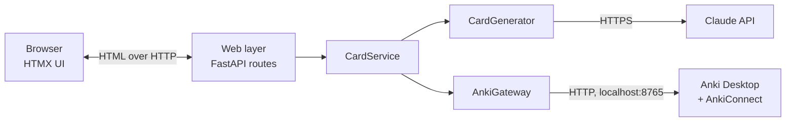
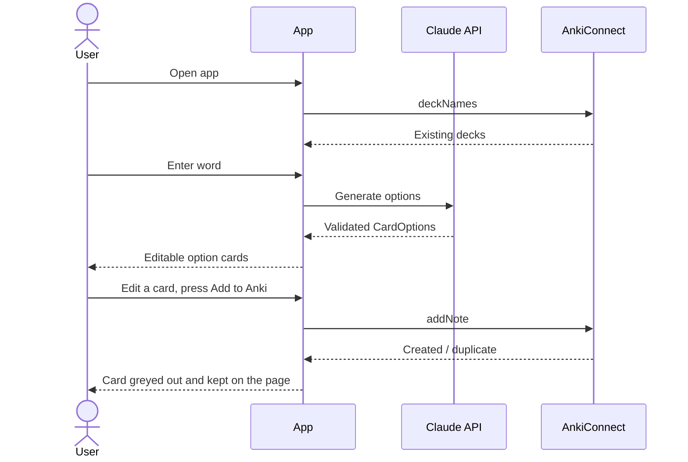

# Anki Cards Creator: Architecture

A local, single-user web app. The user picks a deck (preselected from `DEFAULT_DECK`) and enters a word. An LLM
proposes several card options, the user edits them and adds each one they want, and only then are the cards added to Anki.

## Assumptions

- The app is for German vocabulary learning by a Russian speaker, set in the system prompt. One word produces cards with a definition, example and translation, and the model chooses how many options to return.
- It runs on the user's own machine, for one user, with no accounts or hosting.
- Anki Desktop is installed on that machine.

## Key decisions

| Decision | Choice | Why | Alternative rejected |
|---|---|---|---|
| Anki integration | **AnkiConnect** add-on (`localhost:8765`) | Writes straight into the live collection, lists existing decks, detects duplicates | `.apkg` export via `genanki`: needs a manual import step and can't see existing decks or duplicates |
| App shape | **FastAPI** server with a browser UI | Fits the existing Python/uv project; keeps the API key server-side | Desktop GUI: harder to build and iterate on |
| UI | **Jinja2 + HTMX** | The UI is a few forms, so no Node build or second codebase is needed | React: more than this UI needs |
| LLM | **Claude** (`claude-haiku-5-5`) with structured output, behind a small interface | Validated Pydantic objects mean no JSON parsing or repair code | Free-text parsing: fragile |
| Persistence | **None in v1.** Anki stores cards; settings live in a config file | Unapproved drafts only need to live on the page | SQLite: nothing needs it yet |

## System overview



The server binds to `127.0.0.1` only. Routes hold no logic, and `CardService` depends only on the
two interfaces, so it can be tested with fakes and neither Anki nor the LLM provider leaks into it.

## Main flow



**Approval gate:** the only write to Anki's cards is the approve step. Generating never touches
the collection, and drafts live in the page's form fields, so the server keeps no session state.

## Domain model

```python
class CardContent(BaseModel):      # one option; also the LLM output schema
    word: str
    front_text: str
    back_text: str                 # may span several lines

class CardOptions(BaseModel):
    options: list[CardContent]

class AddResult(BaseModel):
    word: str
    status: Literal["created", "duplicate", "failed"]
    note_id: int | None
    error: str | None
```

Options should differ meaningfully: a separate option for each sense of the word, or different
example styles when it has only one sense. The system prompt asks for this.

## Components

### `CardGenerator` (LLM)

```python
class CardGenerator(Protocol):
    def generate(self, word: str, level: str) -> CardOptions: ...
```

`ClaudeCardGenerator` is the only implementation in v1.

- **Call:** one `client.messages.parse()` request with `output_format=CardOptions`; no agent or tools.
- **Model:** `claude-haiku-5-5` with `output_config.effort` set to `low`, since this is short,
  latency-sensitive generation. Move it up only if quality falls short. The model is a config value.
- **Cost:** $0.10 / $0.50 per million input / output tokens, so well under a cent per word.
- **Refusals:** check `stop_reason` before reading output. Haiku 5.5 has no server-side fallback,
  so a refusal is shown as a message with a retry option. Ordinary vocabulary such as medical or
  weapon terms could occasionally trip a safety classifier.
- **Prompt input:** the word is user data, so it goes in the user message and the system prompt stays fixed.

### `AnkiGateway`

```python
class AnkiGateway(Protocol):
    def list_decks(self) -> list[str]: ...
    def add_cards(
        self, deck: str, cards: list[CardContent], allow_duplicates: bool = False
    ) -> list[AddResult]: ...
```

`AnkiConnectGateway` is a thin `httpx` client for the AnkiConnect v6 JSON protocol.

- **Note type:** `add_cards` creates a dedicated "Anki Cards Creator Basic" note type if it's
  missing, so the app can still start while Anki is closed. Its fields are `Front, Back`, with one
  card template, so each note makes one one-sided card (add a reverse template later). Using our own
  note type avoids depending on the user's templates and on Anki's stock "Basic", whose name is
  localized and can be changed.
- **Duplicates:** Anki compares the first field, so a repeat is a card with the same `Front`. Cards
  for the same word with different phrases are allowed. Offer "add anyway" when a repeat is found.
- **Escaping:** Anki fields are HTML. All LLM and user text must be escaped before it is sent, and
  line breaks become `<br>`. Only the formatting tags the prompt allows (`<b>`, `<i>`, `<small>`,
  `<br>`) are kept, and only without attributes.

### `CardService`

Coordinates the use cases `list_decks`, `generate_options` and `approve_cards`. It
maps failures to the errors the UI can display.

### Web layer

| Method | Path | Purpose |
|---|---|---|
| GET | `/` | Main page: deck selector, word input and level selector (A1–C1, default B1) |
| GET | `/decks` | Refresh the deck selector, with `DEFAULT_DECK` preselected |
| POST | `/options` | Generate options for a word and level; returns an HTML fragment |
| POST | `/cards` | Add one card; returns that card in its new state |
| GET | `/health/anki` | Anki connection status for the UI banner |

## Failure handling

| Failure | Behaviour |
|---|---|
| Anki closed or add-on missing | Banner with instructions; generation still works, and cards stay on the page to retry |
| Duplicate card | Shown on the card, with "add anyway" |
| Card fails to add | Error shown on that card, which stays editable for a retry |
| Rate limit or network error | SDK retries, then a message with a retry button |
| Refusal or truncated output | Clear message with a retry option; never show partial cards |
| Missing API key | Fails at startup with a message saying what to set |

## Configuration

`pydantic-settings`, reading a `.env` file (add it to `.gitignore`):

| Setting | Default |
|---|---|
| `ANTHROPIC_API_KEY` | required |
| `LLM_MODEL` | `claude-haiku-5-5` |
| `LLM_EFFORT` | `low` |
| `ANKI_CONNECT_URL` | `http://127.0.0.1:8765` |
| `DEFAULT_DECK` | empty (no deck preselected) |

## Project layout

```
src/anki_cards_creator/
├── main.py            # FastAPI app and wiring
├── config.py          # Settings
├── domain.py          # CardContent, CardOptions, AddResult, errors
├── service.py         # CardService
├── llm/
│   ├── base.py        # CardGenerator protocol
│   ├── claude.py      # ClaudeCardGenerator
│   └── prompts.py
├── anki/
│   ├── base.py        # AnkiGateway protocol
│   ├── anki_connect.py
│   └── note_type.py   # Field and template definitions
└── web/
    ├── routes.py
    ├── templates/
    └── static/
tests/
```

The root `main.py` placeholder is replaced by this package.

**Dependencies:** `fastapi`, `uvicorn`, `jinja2`, `python-multipart`, `httpx`, `anthropic`,
`pydantic-settings`. Dev: `pytest`, `ruff`. HTMX is a single vendored JS file.

## Testing

- **Service:** `CardService` with fake `CardGenerator` and `AnkiGateway`.
- **Gateway:** `AnkiConnectGateway` against a mocked HTTP transport, including escaping and duplicates.
- **Routes:** FastAPI `TestClient` with fakes.
- **Live checks:** a small manual script for the real Claude API and real Anki, not part of CI.

## Build order

1. **Anki:** package skeleton, `AnkiConnectGateway`, note type, then add a hard-coded card.
2. **LLM:** `ClaudeCardGenerator` and prompt, tuned on sample words from a script.
3. **Service and UI:** `CardService`, routes and templates for the full flow.
4. **Hardening:** failure handling, the Anki status banner and duplicate handling.

## Later

Audio (AnkiConnect can attach media), images, batch word lists, reverse cards, `.apkg` export as a
second `AnkiGateway`, and triggering Anki sync after adding cards.
